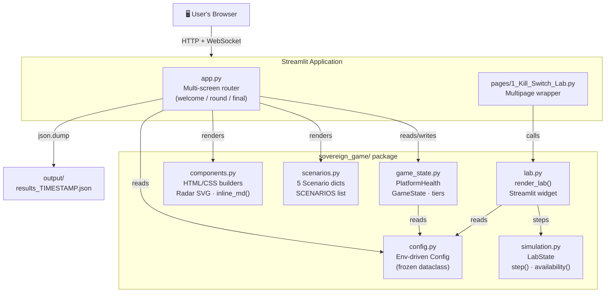
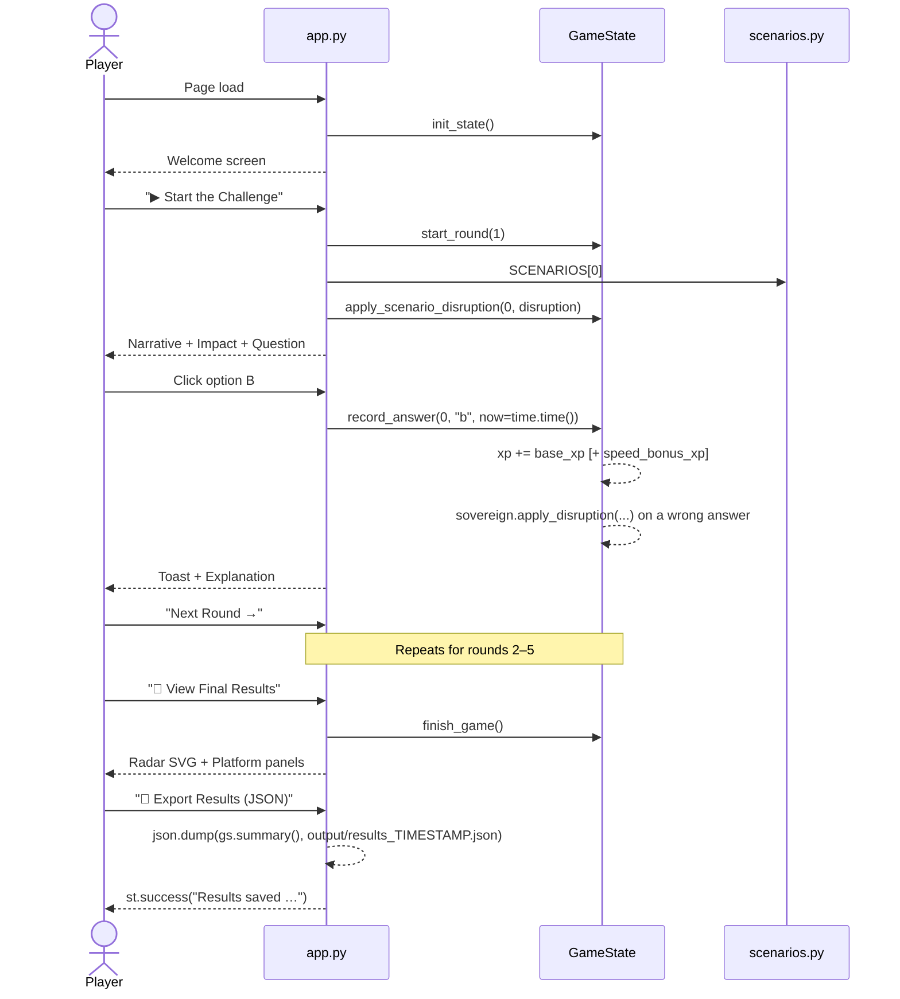
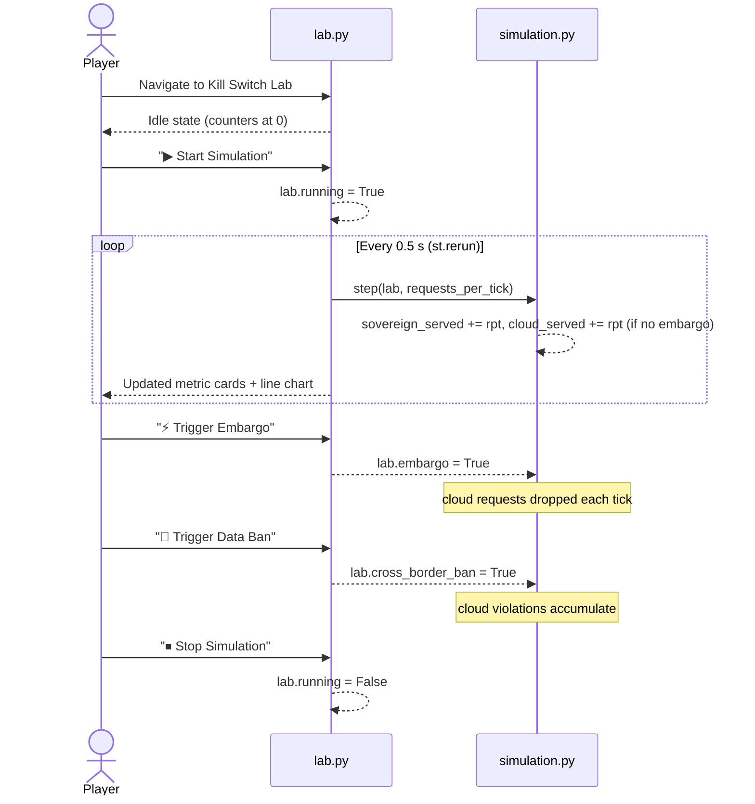

# Architecture — Sovereign AI Challenge

This document describes the internal structure of the Sovereign AI Challenge demo application. It is intended for developers who want to understand, extend, or customise the codebase.

---

## High-Level Architecture



---

## Module Responsibilities

### `sovereign_game/config.py`

A `frozen dataclass` (`Config`) that holds all tunable values. Every field maps directly to an environment variable (see [`../.env.example`](../.env.example)).

`load_config(env?)` is the only public function. It is called once per Streamlit session from `app.py`.

### `sovereign_game/game_state.py`

Pure Python — no Streamlit imports.

- **`PlatformHealth`** — uptime / compliance / AI reliability / political risk for one platform (0–100). `apply_disruption()` lowers metrics when a round starts.
- **`GameState`** — the full session: XP, round number, both `PlatformHealth` objects, and a dict of `RoundResult` objects.
- **`record_answer()`** — validates the chosen option, computes XP (with speed bonus), updates health metrics.
- **`TIER_LABELS / TIER_THRESHOLDS`** — drives the XP progress bar and tier badge in the sidebar.
- **`init_state()` / `reset_state()`** — create/replace the `GameState` in `st.session_state["gs"]`.

### `sovereign_game/scenarios.py`

A plain Python list (`SCENARIOS`) of `dict` objects. Each dict has:

| Key | Type | Purpose |
|---|---|---|
| `id` | str | Unique identifier for JSON export |
| `title` | str | Round heading (emoji prefix supported) |
| `tags` | list[str] | Badge labels |
| `narrative` | str | Story paragraph shown before the question |
| `sovereign_impact` | str | What happens on IBM Sovereign Core |
| `external_impact` | str | What happens on the public cloud |
| `question` | str | Multiple-choice question text |
| `options` | dict[str, str] | Keys `a`–`d`, option text values |
| `correct` | str | Key of the correct option (`"a"`–`"d"`) |
| `explanation` | str | Post-answer rationale (supports `**bold**`) |
| `ibm_feature` | str | IBM Sovereign Core feature name shown in the explanation box |
| `disruption` | dict | Metric deltas for `sovereign` and `external` sides (see below) |

**Disruption schema:**

```python
"disruption": {
    "sovereign": {"uptime_loss": 0, "compliance_loss": 0, "ai_loss": 0, "risk_gain": 0},
    "external":  {"uptime_loss": 55, "compliance_loss": 20, "ai_loss": 60, "risk_gain": 45},
}
```

Each value is subtracted (or added for `risk_gain`) from the current health metric when the round starts.

### `sovereign_game/components.py`

HTML/CSS string builders. No Streamlit calls — everything returns raw HTML that is passed to `st.markdown(..., unsafe_allow_html=True)`.

Key functions:

| Function | Returns |
|---|---|
| `base_styles()` | `<style>` block injected once per page |
| `platform_health_card(name, uptime, compliance, ai_reliability, political_risk, card_class)` | A metric card with four coloured progress bars |
| `scenario_header(title, tags, round_num, max_rounds)` | Title + tag badges |
| `impact_grid(sovereign_text, external_text)` | Blue/red side-by-side impact panels |
| `round_progress_bar(current_round, max_rounds)` | Round progress indicator |
| `score_grid(items)` / `comparison_table(rows)` | Final-screen score cards and sovereign-vs-external table |
| `explanation_box(text, feature)` | "Why this matters" box with bold support |
| `toast(message, kind)` | Notification banner (success / error / info / warn) |
| `radar_chart_svg(labels, sovereign_values, external_values, size)` | Pure SVG radar chart |
| `xp_progress_bar(current_xp, next_threshold, tier_name)` | XP progress bar HTML for the sidebar |
| `inline_md(text)` | Converts `**bold**` to `<strong>` for use inside HTML |

### `sovereign_game/simulation.py`

Pure functions — no Streamlit, no I/O. Can be unit tested without any Streamlit context.

- **`LabState`** — `tick`, `running`, the `embargo` and `cross_border_ban` flags, per-platform `*_served` / `*_failed` / `*_violations` counters and a `history` list used for the chart.
- **`step(lab, requests_per_tick)`** — advances one tick: the sovereign side always serves; the cloud side fails every request under embargo, otherwise serves them and counts each one as a violation when the cross-border ban is active.
- **`availability(served, failed)`** — percentage of requests that were served.
- **`compliance_rate(served, violations)`** — percentage of requests with no violation.
- **`reset(lab)`** — clears all counters.

### `sovereign_game/lab.py`

Calls `render_lab()` which renders the complete Kill Switch Lab UI using Streamlit:

- Four metric cards (Sovereign Served, Cloud Served, Cloud Failed, Cloud Compliance).
- A `st.line_chart` of cumulative served requests with two series (IBM Sovereign Core in purple, Public Cloud AI in red).
- A loop using `time.sleep(0.8)` + `st.rerun()` while the simulation is running.
- Expandable explanation panel with a comparison table.

---

## Data Flow: Game Session



---

## Data Flow: Kill Switch Lab



---

## Session State

Streamlit's `st.session_state` holds:

| Key | Type | Description |
|---|---|---|
| `gs` | `GameState` | The active game session |
| `lab` | `LabState` | The Kill Switch Lab state (created lazily on first visit) |

Both objects are plain Python dataclasses — no Streamlit references inside them, which is what makes them unit-testable.

---

## Testing Strategy

```
tests/
├── test_game.py       # Unit tests for config, game_state, scenarios, simulation
└── test_app_flow.py   # AppTest end-to-end flows: welcome → rounds → final
```

`test_game.py` exercises `Config`, `PlatformHealth`, `GameState`, the scenarios and `simulation.*` without starting a browser.

`test_app_flow.py` uses Streamlit's built-in `AppTest` to simulate button clicks and verify session state.

Run with coverage:

```bash
bash scripts/test.sh
```

---

## Extending the Application

### Adding a new scenario

1. Append a new dict to `SCENARIOS` in [`sovereign_game/scenarios.py`](../sovereign_game/scenarios.py).
2. Update `MAX_ROUNDS_DEFAULT` in [`game_state.py`](../sovereign_game/game_state.py) to match the new list length (the round count is a constant, not derived from the list).
3. Update the `len(SCENARIOS) == 5` assertion in `tests/test_game.py`.

### Changing colours / styles

Edit the CSS strings in [`sovereign_game/components.py`](../sovereign_game/components.py) — specifically:
- `IBM_BLUE = "#0F62FE"` and `SOVEREIGN_PURPLE = "#6929C4"` at the top of the file.
- The `base_styles()` function for global CSS.

### Adding a new page

Drop a `.py` file into `pages/`. Streamlit discovers it automatically. Follow the pattern in `pages/1_Kill_Switch_Lab.py`.

### Deploying in a container

A `Containerfile` (Podman-compatible) is not included by default to keep the project lightweight, but the application has no OS-level dependencies beyond Python 3.12. A simple single-stage image works:

```dockerfile
FROM python:3.12-slim
WORKDIR /app
COPY requirements.txt .
RUN pip install --no-cache-dir -r requirements.txt
COPY . .
EXPOSE 8501
CMD ["python", "-m", "streamlit", "run", "app.py", \
     "--server.port=8501", "--server.headless=true", \
     "--browser.gatherUsageStats=false"]
```
