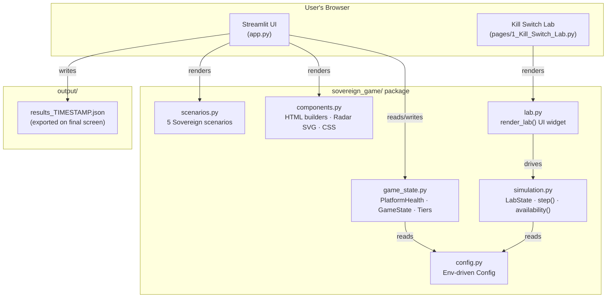
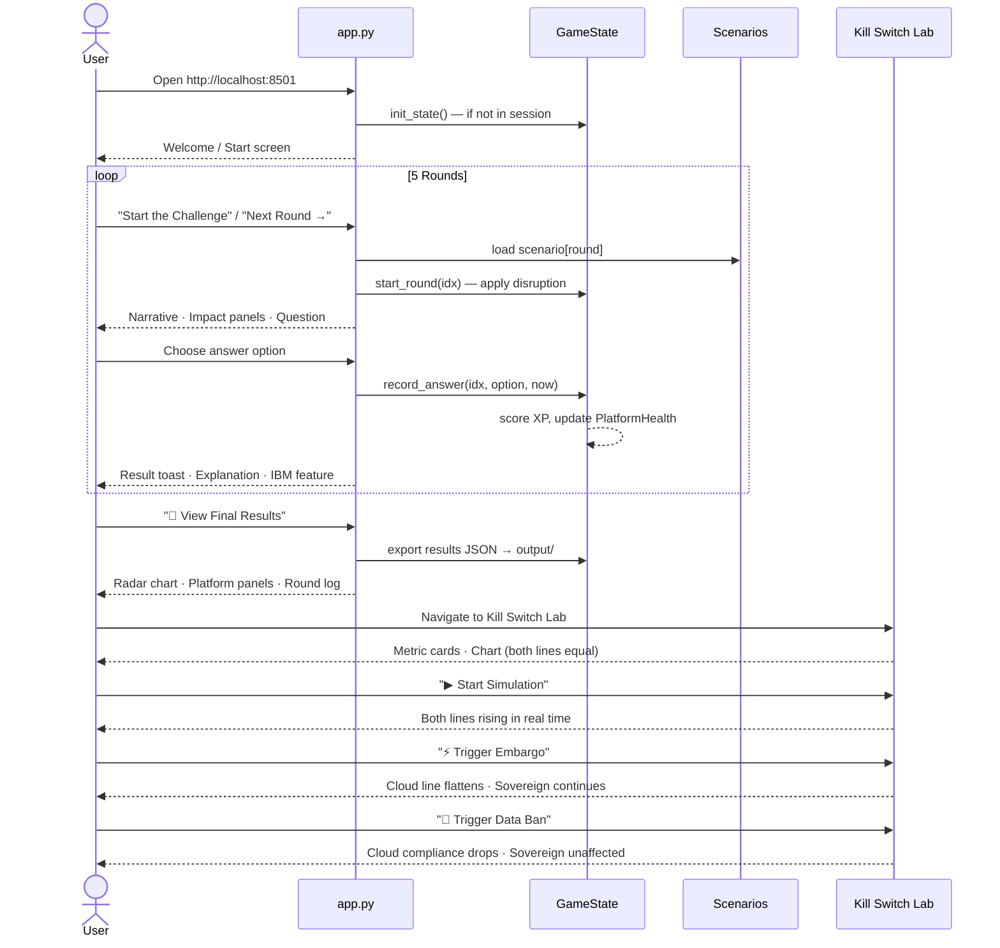

# 🛡️ Sovereign AI Challenge

> **An interactive gamification demo that illustrates the real-world advantages of running AI inside an air-gapped, customer-controlled environment with IBM Sovereign Core — and the risks of depending on public-cloud AI that can be switched off at any time.**

---

## Architecture



---

## Application Flow



---

## Features

| Feature | Description |
|---|---|
| **5 game scenarios** | Political Kill Switch · Compliance Audit Surprise · Data Exfiltration Suspicion · GPU Shortage Emergency · The New Regulation |
| **XP & tiers** | Observer → Analyst → Architect → Sovereign Guardian → Master of Sovereignty |
| **Speed bonus** | Extra XP for answering within 10 s |
| **Live health bars** | Sidebar shows running Uptime / Compliance / AI Reliability / Political Risk for each platform |
| **Final screen** | Radar SVG · side-by-side platform summary · "Play Again" |
| **Kill Switch Lab** | Real-time Streamlit chart; Embargo and Data Ban toggles split the two platform lines |
| **JSON export** | "Export Results (JSON)" button on the final screen writes `output/results_<unix-time>.json` |
| **No cloud** | Runs fully offline; no external API calls |

---

## Quick Start

```bash
# 1. Clone (or unzip)
cd sovereign-core-demo

# 2. Copy config (optional — all defaults work out of the box)
cp .env.example .env

# 3. Start (creates .venv automatically via uv)
bash scripts/start.sh

# 4. Open the URL printed to the console
#    http://localhost:8501
```

See [`Docs/Quickstart.md`](Docs/Quickstart.md) for a step-by-step walkthrough including demo tips.

---

## Project Structure

```
sovereign-core-demo/
├── app.py                      # Main Streamlit app (welcome / round / final)
├── pages/
│   └── 1_Kill_Switch_Lab.py    # Multipage wrapper for the Lab
├── sovereign_game/
│   ├── __init__.py
│   ├── config.py               # Env-driven Config dataclass
│   ├── game_state.py           # PlatformHealth, GameState, tiers
│   ├── scenarios.py            # 5 scenario definitions
│   ├── components.py           # HTML/CSS builders, Radar SVG
│   ├── simulation.py           # LabState deterministic simulator
│   └── lab.py                  # render_lab() Streamlit widget
├── tests/
│   ├── test_game.py            # Unit tests for game logic
│   └── test_app_flow.py        # AppTest end-to-end tests
├── scripts/
│   ├── start.sh                # Launch in detached mode
│   ├── stop.sh                 # Graceful shutdown
│   ├── cleanup.sh              # Remove .venv, node_modules, __pycache__
│   └── test.sh                 # Run test suite + coverage
├── .streamlit/config.toml      # Force light theme
├── .env.example                # Template for environment variables
├── requirements.txt            # Runtime deps (streamlit; pandas comes with it)
├── requirements-dev.txt        # Dev deps (pytest, pytest-cov)
├── Docs/
│   ├── Quickstart.md           # Step-by-step setup and demo guide
│   └── Architecture.md         # Deep-dive architecture with Mermaid diagrams
├── input/                      # (empty keeper) — for future input docs
└── output/                     # Game result JSON files are written here
```

---

## Configuration

All settings are read from environment variables (or `.env`). The defaults work for every demo without any configuration:

| Variable | Default | Description |
|---|---|---|
| `APP_TITLE` | `Sovereign AI Challenge` | Browser tab title |
| `SERVER_PORT` | `8501` | Streamlit server port |
| `BASE_XP` | `200` | XP awarded for a correct answer |
| `SPEED_BONUS_XP` | `50` | Extra XP for answering within the speed window |
| `SPEED_BONUS_SECONDS` | `10` | Speed window in seconds |
| `WRONG_ANSWER_PENALTY` | `15` | Metric deduction on the sovereign side for a wrong answer |
| `SIM_REQUESTS_PER_TICK` | `120` | AI requests per simulation tick in the Kill Switch Lab |
| `SHOW_DISCLAIMER` | `true` | Show the "demonstration purposes only" footer |
| `OUTPUT_DIR` | `output` | Directory for exported JSON results |

---

## Customising Scenarios

Edit [`sovereign_game/scenarios.py`](sovereign_game/scenarios.py). Each scenario is a plain `dict`:

```python
{
    "id": "my_scenario",
    "title": "⚡ My Scenario",
    "tags": ["Data Sovereignty", "Operational Continuity"],
    "narrative": "The situation... (**bold** is supported)",
    "sovereign_impact": "✅ What happens on IBM Sovereign Core",
    "external_impact": "🔴 What happens on the public cloud",
    "question": "Which capability...?",
    "options": {"a": "...", "b": "...", "c": "...", "d": "..."},
    "correct": "b",
    "explanation": "Why **b** is correct.",
    "ibm_feature": "Feature name · Pillar name",
    # Metric changes applied when the round starts (all values 0-100)
    "disruption": {
        "sovereign": {"uptime_loss": 0, "compliance_loss": 0, "ai_loss": 0, "risk_gain": 0},
        "external": {"uptime_loss": 55, "compliance_loss": 20, "ai_loss": 60, "risk_gain": 45},
    },
}
```

The list `SCENARIOS` in [`scenarios.py`](sovereign_game/scenarios.py) drives the game in order. Add, remove or reorder entries freely, then set `MAX_ROUNDS_DEFAULT` in [`game_state.py`](sovereign_game/game_state.py) to the new list length and update the `len(SCENARIOS) == 5` assertion in `tests/test_game.py`.

---

## Scripts

| Script | Purpose |
|---|---|
| `scripts/start.sh` | Start in background, print URL, wait for health check |
| `scripts/stop.sh` | Read PID file, send SIGTERM |
| `scripts/cleanup.sh` | Remove `.venv`, `node_modules`, `__pycache__`, `.run/` |
| `scripts/test.sh` | Activate `.venv`, run pytest with coverage, print report |

---

## Running Tests

```bash
bash scripts/test.sh
```

Or directly:

```bash
.venv/bin/python -m pytest -q --tb=short
```

---

## Licence

MIT — see [`LICENSE`](LICENSE).

> **Disclaimer:** All metrics, figures, and scenarios in this application are illustrative and produced for demonstration purposes only. IBM Sovereign Core product capabilities are based on publicly available materials. © 2026 IBM Corporation.

---

## Sources

- IBM Sovereign Core client presentation deck (provided)
- IBM IBV survey: 58% of IT leaders disrupted by supply-chain choke points
- Gartner forecast: 75% of enterprises will have a digital sovereignty strategy by 2030
- IBM Sovereign Core positioning: "Enterprises don't need another cloud. Enterprises need sovereignty and control they can prove."
